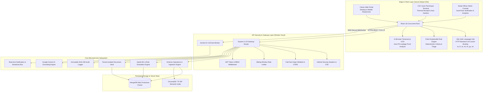
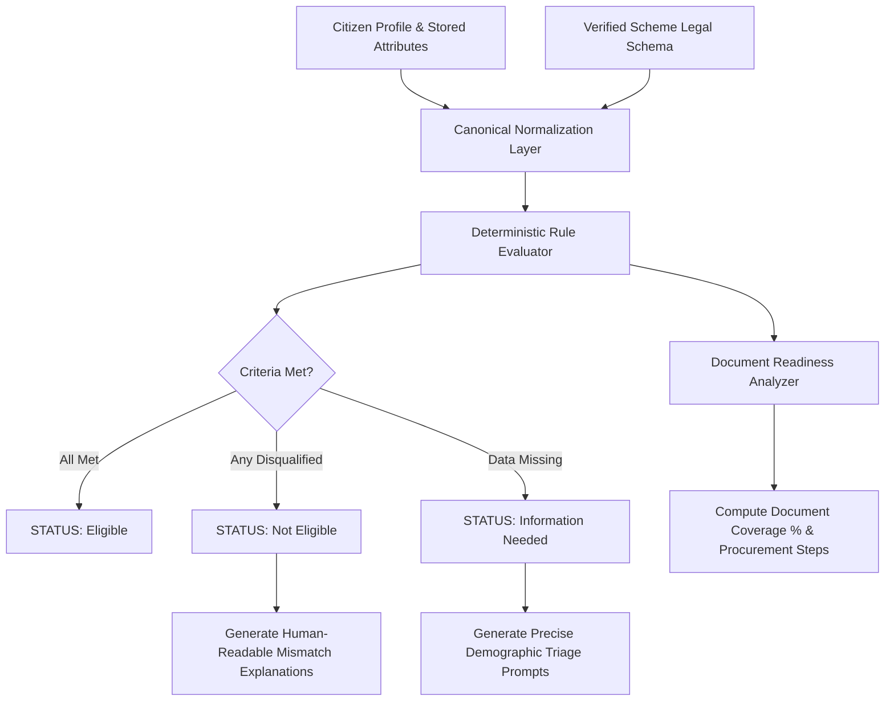

# 🇮🇳 GovScheme AI — Enterprise Multilingual Welfare & Eligibility Platform

[](https://govhelp.vercel.app/)
[](https://govscheme-api.onrender.com/)
[](https://github.com/NITISH1817/GovScheme)
[](https://github.com/NITISH1817/GovScheme)
[](https://github.com/NITISH1817/GovScheme)
[](https://www.typescriptlang.org/)
[](https://react.dev/)
[](https://nodejs.org/)
[](LICENSE)

**GovScheme AI** is an enterprise-grade, explainable public welfare discovery and citizen guidance engine engineered to overcome the digital divide in Indian public welfare access. Uniting deterministic legal rule verification, zero-leakage client-side OCR extraction, high-accuracy semantic search with Indic script transliteration, real-time WebSocket administrative oversight, and Common Service Center (CSC) kiosk support, GovScheme AI empowers 1.4 billion citizens to discover, verify, and apply for government entitlements without middlemen or fraud.

---

## 🌐 Live Deployments & Endpoints

| Environment | Service | URL | Architecture |
| :--- | :--- | :--- | :--- |
| **Production** | Citizen Experience (Frontend) | [https://govhelp.vercel.app](https://govhelp.vercel.app/) | Vercel Edge Network (React 18 + Vite SPA) |
| **Production** | REST & Socket API (Backend) | [https://govscheme-api.onrender.com](https://govscheme-api.onrender.com/) | Render Cloud Container (Node.js 20 + Express) |
| **Data Layer** | Scheme & Citizen Store | MongoDB Atlas / High-Availability Replica Set | Mongoose 9.x Schema Validation & Indices |
| **Repository** | Official Source Code | [https://github.com/NITISH1817/GovScheme](https://github.com/NITISH1817/GovScheme) | GitHub Main Branch |

---

## 🏛️ High-Level Enterprise Architecture



---

## 🌟 Core Technical Innovations

### 1. Dual-Engine Explainable Eligibility Matching (No Black Boxes)
Public welfare delivery requires total transparency. Citizens cannot be denied welfare based on unverifiable machine-learning confidence scores. GovScheme AI implements a **deterministic legal verification engine** paired with **explainable affinity scoring**:
* **Strict Legal Verification**: Evaluates age bounds, income ceilings, domicile/state restrictions, social categories (General/OBC/SC/ST), target genders, occupation classes, disability thresholds, and land-holding ceilings.
* **Granular Criteria Classification**: Every criterion is categorized into `SATISFIED`, `NOT_SATISFIED`, or `UNKNOWN`.
* **Zero False Assumptions**: Missing demographic inputs result in `UNKNOWN` and prompt the citizen with the exact missing fields instead of issuing erroneous rejections or unearned approvals.
* **Actionable Document Readiness**: Compares required verification documents against uploaded records and outputs an exact percentage with guided next steps.



### 2. Multi-Script Indic Search & Phonetic Transliteration
GovScheme AI provides first-class support for 7 major Indian languages with full bidirectional query resolution:
* **Native Regional Script Engine**: Full Unicode text indexing in **Tamil (தமிழ்)**, **Hindi (हिन्दी)**, **Telugu (తెలుగు)**, **Malayalam (മലയാളം)**, **Marathi (मराठी)**, and **Gujarati (ગુજરાતી)**.
* **Latin Transliteration Support**: Resolves colloquial Latin-script phonetic variations to target welfare domains (e.g., `"vyavasayam"`, `"vivsay"`, `"kisan"`, `"vidyarthi"`, `"magalir"`, `"illam"`).
* **Negative Intent & Exclusion Filter**: Accurately recognizes exclusion phrases (e.g., *"not having land"*, *"no income certificate"*) without hallucinating mismatched schemes.
* **Anti-Hallucination & Scam Defense**: Queries attempting to search for fraudulent or non-existent welfare schemes receive clear disclaimers with direct links to verified `.gov.in` and `.nic.in` state and central domains.

### 3. Fully Synchronized i18n Hub with v19 Cache-Busting
* **Zero Fallback Leaks**: Every interactive element, filter category, verification badge, card explanation, and status indicator maps to authoritative localized dictionary keys across all supported locales.
* **Versioned Cache Invalidation**: Employs `/locales/{{lng}}/translation.json?v=19` to guarantee that CDN edge servers and citizen browsers instantly receive newly deployed translations without stale cache retention.
* **Dynamic Demographic Mapping**: Missing profile fields (`Full Name`, `Annual Income`, `Occupation`, etc.) dynamically translate to the citizen's chosen language within notification banners.

### 4. Zero-PII-Leakage Document Vault & Browser-Local OCR
* **Client-Side Optical Character Recognition**: Uses in-browser `Tesseract.js` workers to parse Aadhaar numbers, PAN identifiers, and income declarations locally on the citizen's device before any network transmission.
* **Tenant Isolation**: Uploaded documents are partitioned strictly by authenticated user ID with strict MIME-type validation, size limits (10MB), and virus scanning heuristics.
* **Dual-Pane Officer Verification**: Administrative nodal officers inspect uploaded proofs side-by-side with OCR-extracted values, enabling 1-click approvals, rejections, or resubmission requests.

### 5. CSC Gram Panchayat Kiosk Mode
* **Engineered for Rural Connectivity**: Tailored for Common Service Center (CSC) village operators handling multiple citizens on a single terminal.
* **Automated Session Cleanup**: Automatically purges in-memory cached citizen data, resets search filters, and sanitizes storage between sessions.
* **Printable Thermal Eligibility Slips**: Generates printer-optimized 80mm thermal receipts summarizing recommended schemes, estimated benefits, required documents, and CSC operator verification stamps.

### 6. Fail-Closed Production Build Guard
* Built directly into [`vite.config.ts`](file:///c:/Users/nitishpriyanrs/OneDrive/Documents/new_miniproject/GovScheme/vite.config.ts) to enforce production deployment invariants:
  - Strict HTTPS endpoint validation (rejects unencrypted `http:` endpoints).
  - Loopback rejection (strictly fails builds if `localhost`, `127.0.0.1`, `0.0.0.0`, or `.local` are configured in production).
  - Uncompromised local developer experience (`npm run dev` functions seamlessly without manual overrides).

---

## 🗂️ Verified Schemes Catalogue (75 Flagship Schemes)

The platform curates an authoritative, verified database spanning Central Government ministries and State welfare departments:

```
GovScheme Welfare Matrix
├── Central Government Flagships
│   ├── Agriculture: PM-KISAN, PM Fasal Bima Yojana (PMFBY), Kisan Credit Card (KCC)
│   ├── Social Security: Atal Pension Yojana (APY), PM-SYM, PMJJBY, PMSBY, National Social Assistance
│   ├── Healthcare: Ayushman Bharat (PM-JAY), Janani Suraksha Yojana, Mission Indradhanush
│   ├── MSME & Credit: PM SVANidhi, PM Mudra Yojana, Stand-Up India, PMEGP, PM Vishwakarma
│   └── Housing: Pradhan Mantri Awas Yojana (PMAY-G & PMAY-U), Jal Jeevan Mission
└── State Welfare Flagships
    ├── Tamil Nadu: Kalaignar Kanavu Illam, Kalaignar Magalir Urimai Thogai (KMUT), CMCHIS, Moovalur Ramamirtham Pudhumai Penn, Tamil Puthalvan, Naan Mudhalvan
    ├── Maharashtra: Majhi Ladki Bahin Yojana, Mahatma Jyotirao Phule Jan Arogya Yojana, Sanjay Gandhi Niradhar
    ├── Kerala: Karunya Arogya Suraksha Padhathi (KASP), LIFE Housing Mission, Kudumbashree
    └── Karnataka: Gruha Lakshmi, Anna Bhagya, Yuva Nidhi, Shakti Scheme
```

---

## 🛠️ Complete Technology Stack

| Layer | Technology | Version | Purpose |
| :--- | :--- | :--- | :--- |
| **Frontend Framework** | React | `18.3.1` | Concurrent UI rendering, error boundaries, hooks architecture |
| **Type System** | TypeScript | `5.5.3` | Strict static typing, comprehensive domain interfaces |
| **Build & Dev Tool** | Vite | `5.4.21` | Native ESM HMR, roll-up chunking, fail-closed production guard |
| **Styling & Icons** | Tailwind CSS / Lucide | `3.4.1` / `0.344` | Utility-first styling, dark/light themes, WCAG contrast compliance |
| **Animation & UX** | Framer Motion | `11.0.8` | Micro-interactions, smooth page transitions, modal spring physics |
| **Data Visualizations**| Recharts | `2.12.2` | Interactive analytics charts, benefit breakdowns, KPIs |
| **Internationalization**| i18next & Http-Backend| `23.10` / `2.4.3` | Indic translation loading, v19 cache buster, language detection |
| **Client OCR Engine** | Tesseract.js | `5.0.5` | In-browser document text extraction without cloud PII exposure |
| **Real-Time Layer** | Socket.IO / Client | `4.8.1` | Push broadcasts, application status updates, live alerts |
| **Backend Runtime** | Node.js / Express | `20+` / `4.19.2` | High-throughput asynchronous REST microservices |
| **Security Middleware**| Helmet, Express Rate Limit | `8.3.0` / `7.4.0` | CSP headers, rate-limiting windows, origin whitelisting |
| **Authentication** | JSON Web Tokens & bcryptjs| `9.0.2` / `2.4.3` | HMAC-SHA256 stateless tokens, salted password hashing |
| **Database & ODM** | MongoDB Atlas / Mongoose | `9.9.0` | Schema-enforced document storage with in-memory zero-setup fallback |

---

## 🔌 Comprehensive API Specification

All backend endpoints are rooted at `/api` and adhere to RESTful conventions:

### Authentication & Citizen Profile
| Method | Endpoint | Authorization | Description |
| :--- | :--- | :--- | :--- |
| `POST` | `/api/users/register` | Public | Register new citizen account (strictly assigns role: `Citizen`) |
| `POST` | `/api/users/login` | Public | Authenticate citizen or admin, returns signed JWT token |
| `GET` | `/api/users/profile` | `Bearer <JWT>` | Retrieve authenticated citizen profile & eligibility metrics |
| `PUT` | `/api/users/profile` | `Bearer <JWT>` | Update demographic profile (income, age, occupation, location) |

### Scheme Discovery & Explainable Eligibility
| Method | Endpoint | Authorization | Description |
| :--- | :--- | :--- | :--- |
| `GET` | `/api/schemes` | Public | Retrieve published schemes with multi-filter and pagination |
| `GET` | `/api/schemes/:id` | Public | Retrieve detailed scheme dossier, criteria, and documentation |
| `POST` | `/api/search` | Public | Multilingual semantic search with Indic transliteration matching |
| `POST` | `/api/search/eligibility` | Optional | Execute deterministic rule evaluation against citizen attributes |

### Document Vault & OCR Services
| Method | Endpoint | Authorization | Description |
| :--- | :--- | :--- | :--- |
| `POST` | `/api/documents/upload` | `Bearer <JWT>` | Upload document to isolated citizen vault (PDF/PNG/JPEG, max 10MB) |
| `GET` | `/api/documents/my-vault` | `Bearer <JWT>` | Fetch authenticated citizen's document repository |
| `DELETE`| `/api/documents/:id` | `Bearer <JWT>` | Securely purge document from isolated vault |
| `POST` | `/api/ocr/scan` | `Bearer <JWT>` | Trigger server-side validation & verification check on document |

### Applications & Administrative Nodal Operations
| Method | Endpoint | Authorization | Description |
| :--- | :--- | :--- | :--- |
| `POST` | `/api/applications` | `Bearer <JWT>` | Submit citizen application for verified scheme |
| `GET` | `/api/applications/my` | `Bearer <JWT>` | View submitted applications and live status history |
| `GET` | `/api/admin/analytics` | `Admin Only` | High-level system KPIs, demographic distributions, match rates |
| `GET` | `/api/admin/audit-logs` | `Admin Only` | Immutable audit trail of system events, logins, and approvals |
| `GET` | `/api/admin/applications`| `Admin Only` | Queue of citizen applications awaiting nodal review |
| `PUT` | `/api/admin/applications/:id`| `Admin Only` | Approve, reject, or request resubmission on application |

---

## ⚡ Quick Start & Development Setup

### System Prerequisites
* **Node.js**: `v20.x` or higher (LTS recommended)
* **npm**: `v9.x` or higher
* **Git**: `v2.x`

### 1. Repository Setup
```bash
# Clone the official repository
git clone https://github.com/NITISH1817/GovScheme.git
cd GovScheme

# Install all workspace dependencies across client and server
npm install
```

### 2. Environment Configuration
Create a `.env` file in the project root:
```env
# Server Configuration
PORT=5000
NODE_ENV=development

# Security Secret (Minimum 32 characters required)
JWT_SECRET=govscheme_enterprise_secure_jwt_token_2026_production_grade_key

# Database (Leave empty or unreachable to use automatic in-memory MongoDB store)
MONGODB_URI=mongodb://localhost:27017/govscheme

# Frontend API Target (Vite development default)
VITE_API_URL=http://localhost:5000

# Optional: Google Gemini AI API Key
GEMINI_API_KEY=your_gemini_api_key_here
```

### 3. Launch Development Servers
```bash
# Terminal 1: Launch Backend API Server (with auto-reload)
npm run server
# -> Backend active on http://localhost:5000

# Terminal 2: Launch Vite Frontend Client
npm run dev
# -> Vite dev server active on http://localhost:5173
```

### 4. Built-in Test Credentials
| Role | Email | Password | Access Rights |
| :--- | :--- | :--- | :--- |
| **System Administrator** | `admin@govscheme.in` | `password123` | Full Admin Console, Audit Logs, Application Processing |
| **Citizen Test User** | `citizen@govscheme.in` | `password123` | Citizen Portal, Application Tracking, Document Vault |

---

## 🧪 Comprehensive Automated Test Suites

GovScheme AI maintains an exhaustive suite of **14 test suites** comprising **120+ assertions** across security, rules, multilingual transliteration, and build invariants:

```bash
# Run the entire test battery
npm test
```

### Verified Test Suites Matrix
| Suite | File Path | Focus Area |
| :--- | :--- | :--- |
| **1. Auth & Registration** | `tests/auth_end_to_end_fixes.test.js` | Strict role assignment, password hashing, and token issuance |
| **2. JWT & CORS Security** | `tests/jwt_cors_hardening.test.js` | Fail-fast JWT secret validation, origin whitelisting, CORS |
| **3. Vulnerability Defense** | `tests/security_vulnerabilities.test.js` | Rate limiting, privilege escalation defense, credential audits |
| **4. Vault & OCR Isolation** | `tests/ocr_isolation_recommendation.test.js`| Tenant data isolation, document security, and field mapping |
| **5. Profile Persistence** | `tests/signup_profile_persistence.test.js` | Schema validation and demographic state persistence |
| **6. Application Lifecycle**| `tests/admin_citizen_lifecycle.test.js` | Citizen application flow from submission to nodal approval |
| **7. Scheme System** | `tests/scheme_recommendation_and_system.test.js` | Backend rule engine compatibility and scoring |
| **8. ML Architecture** | `tests/ai_ml_architecture_audit.test.js` | Recommendation confidence accuracy and weight boundaries |
| **9. Grounded AI & Anti-Scam**| `tests/search_and_grounded_ai.test.js` | Anti-hallucination guardrails and official portal grounding |
| **10. Explainable Rules** | `tests/explainable_eligibility.test.js` | Deterministic criteria evaluation, missing field triage |
| **11. Multilingual Search**| `tests/multilingual_search.test.js` | Indic script indexing, transliteration, Unicode normalization |
| **12. Production Guard** | `tests/production_build_guard.test.js` | Fail-closed build guard enforcing HTTPS production URLs |
| **13. Kiosk Mode Security**| `tests/kiosk_auth_flow.test.js` | Kiosk session sanitization, auth prompt, thermal printing |
| **14. Scheme Verification** | `tests/scheme_verification_semantics.test.js` | Admin verification semantics and portal curated provenance |

### Verification Commands
```bash
# Verify static TypeScript types
npx tsc --noEmit

# Validate production build with HTTPS production API URL
$env:VITE_API_URL="https://govscheme-api.onrender.com"; npm run build

# Validate git whitespace and diff cleanliness
git diff --check
```

---

## 🚀 Deployment Runbook

### Deploying Frontend to Vercel
1. Link GitHub repository `NITISH1817/GovScheme` on [Vercel](https://vercel.com).
2. Configure **Root Directory**: `./`.
3. Set **Build Command**: `npm run build`.
4. Set **Output Directory**: `dist`.
5. Add Environment Variable:
   - `VITE_API_URL`: `https://govscheme-api.onrender.com`
6. Deploy. The fail-closed build guard automatically validates the secure HTTPS configuration during bundling.

### Deploying Backend to Render
1. Create a new **Web Service** on [Render](https://render.com) connected to `NITISH1817/GovScheme`.
2. Configure:
   - **Environment**: `Node`
   - **Build Command**: `npm install`
   - **Start Command**: `npm run start`
3. Configure Environment Variables:
   - `NODE_ENV`: `production`
   - `PORT`: `10000`
   - `JWT_SECRET`: High-entropy 64-character secret
   - `MONGODB_URI`: Production MongoDB Atlas connection URI
   - `GEMINI_API_KEY`: Google Gemini API key

---

## 🛡️ Security, Privacy & Responsible AI Commitments

* **Zero Public PII Exposure**: Citizen Aadhaar numbers, phone numbers, and financial metrics are masked in audit logs and API responses.
* **Middleman & Scam Free**: Proactively educates citizens that government applications are **free of charge** and provides verified toll-free helplines (e.g. Kisan Call Center `1800-180-1551`, Ayushman Bharat `14555`).
* **Inclusive Accessibility**: Designed to WCAG 2.1 AA standards featuring high-contrast color palettes, screen-reader semantic landmarks, dynamic typography scaling, and keyboard navigation.

---

## 📄 License & Attribution

Distributed under the **MIT License**. See [`LICENSE`](file:///c:/Users/nitishpriyanrs/OneDrive/Documents/new_miniproject/GovScheme/LICENSE) for details.

Engineered with ❤️ for the citizens of India by [NITISH1817](https://github.com/NITISH1817) and contributors.
