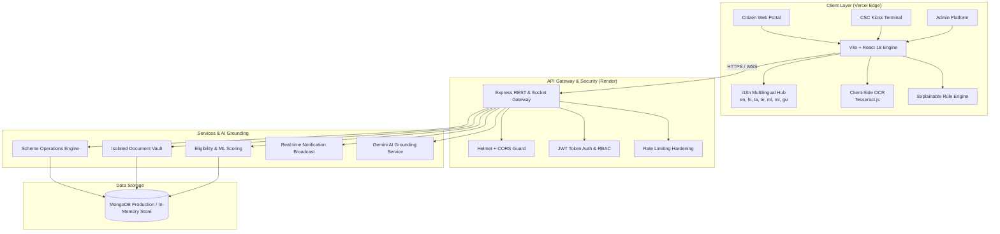
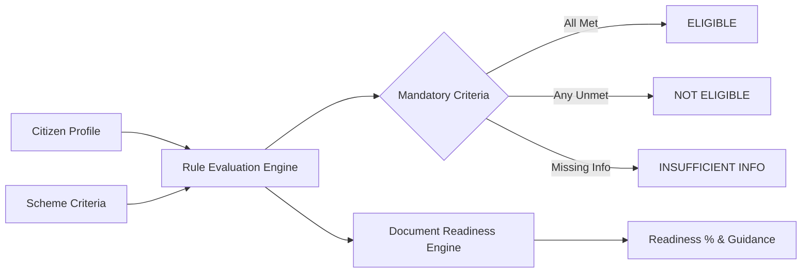

# 🇮🇳 GovScheme AI — Enterprise Multilingual Welfare & Eligibility Platform

[](https://govhelp.vercel.app/)
[](https://govscheme-api.onrender.com/)
[](https://react.dev/)
[](https://www.typescriptlang.org/)
[](https://vitejs.dev/)
[](https://nodejs.org/)
[](https://socket.io/)
[](https://tailwindcss.com/)
[](LICENSE)

**GovScheme AI** is a mission-critical, AI-augmented citizen service delivery and administrative platform engineered to bridge the last-mile digital divide in Indian public welfare delivery. It unites deterministic rule evaluation, explainable eligibility reasoning, multilingual natural language search with Indic transliteration awareness, client-side OCR extraction, and real-time administrative governance into a single secure, resilient system.

---

## 🌐 Live Deployments & Repository Links

* **Citizen Portal (Frontend)**: [https://govhelp.vercel.app](https://govhelp.vercel.app/)
* **Production Backend API**: [https://govscheme-api.onrender.com](https://govscheme-api.onrender.com/)
* **Source Repository**: [https://github.com/NITISH1817/GovScheme](https://github.com/NITISH1817/GovScheme)

---

## 🏛️ System Architecture

GovScheme AI operates on a decoupled client-server architecture with strict separation between public citizen experiences and authenticated administrative workflows:



---

## 🌟 Key Functional Pillars

### 1. Dual-Engine Eligibility & Explainable Matching
Unlike opaque machine-learning black boxes, GovScheme AI uses a hybrid **Explainable Evaluation Pipeline**:
* **Deterministic Rule Verification**: Validates citizenship, age bounds (`[0, 120]`), income ceilings, social categories, occupations, land-holding limits, and residency.
* **Granular Status Breakdowns**: Classifies criteria into `SATISFIED`, `NOT_SATISFIED`, or `UNKNOWN`.
* **Zero False Assumptions**: Missing profile fields yield `UNKNOWN` with precise prompts for missing data rather than false approvals or rejections.
* **Document Readiness Scoring**: Inspects required vs uploaded documentation (Aadhaar, Income Certificate, Community Certificate, Land Records, Ration Card) and computes an actionable readiness percentage.



### 2. Multilingual Discovery & Indic Script Transliteration
* **Native Script Search**: Full semantic indexing across **Hindi (हिन्दी)**, **Tamil (தமிழ்)**, **Telugu (తెలుగు)**, **Malayalam (മലയാളം)**, **Marathi (मराठी)**, and **Gujarati (ગુજરાતી)**.
* **Latin Transliteration Mapping**: Understands colloquial phonetics (e.g., `"vyavasayam"`, `"vivsay"`, `"kisan"`, `"vidyarthi"`, `"magalir"`).
* **Negative-Intent Filtering**: Automatically filters out queries expressing exclusions, negative state selections, or missing documents without degrading valid results.
* **Anti-Hallucination Guardrails**: Detects fake or nonexistent scheme queries and outputs grounded disclaimers pointing strictly to official government portals (`*.gov.in`, `*.nic.in`).

### 3. Client-Side OCR & Strict Document Isolation
* **Zero-Leakage Document Vault**: Documents uploaded by a citizen are strictly isolated by authenticated user tenant ID.
* **Client-Side Extraction**: Leverages `Tesseract.js` directly within the browser for Aadhaar, PAN, and Income certificate verification without streaming unencrypted PII across unnecessary third parties.
* **Dual-Pane Admin Verification**: Administrative nodal officers can cross-examine uploaded proofs alongside extracted data for fast verification.

### 4. CSC Gram Panchayat Kiosk Mode
* Specially crafted for **Common Service Centers (CSCs)** in rural villages.
* Provides single-terminal multi-citizen operation with automatic session teardown, memory cache flushes, and print-ready citizen eligibility cards.

### 5. Safe Production Build Guard (Fail-Closed Invariants)
A custom build-time plugin in [`vite.config.ts`](file:///c:/Users/nitishpriyanrs/OneDrive/Documents/new_miniproject/GovScheme/vite.config.ts) prevents production builds from deploying with insecure or default configurations:
* Rejects missing or empty `VITE_API_URL`.
* Rejects insecure `http:` protocol endpoints.
* Rejects `localhost`, `127.0.0.1`, `[::1]`, `0.0.0.0`, and `.local` targets in production mode.
* Guarantees that local development (`npm run dev`) remains fully independent and unaffected.

---

## 🗂️ Verified Schemes Catalogue (60+ Welfare Schemes)

The platform includes an authoritative catalogue spanning central ministries and state welfare departments:

| Domain | Key Flagship Schemes Included |
| :--- | :--- |
| **Agriculture & Farming** | PM-KISAN, Pradhan Mantri Fasal Bima Yojana (PMFBY), Kisan Credit Card (KCC), PM Krishi Sinchayee Yojana, Soil Health Card Scheme |
| **Social Security & Pension** | Atal Pension Yojana (APY), Pradhan Mantri Shram Yogi Maan-dhan (PM-SYM), National Social Assistance Programme (NSAP), PMJJBY, PMSBY |
| **Education & Youth** | Post-Matric Scholarship, National Means-cum-Merit Scholarship (NMMSS), Tamil Puthalvan, Moovalur Ramamirtham Pudhumai Penn, First Graduate Scheme |
| **Healthcare & Insurance** | Ayushman Bharat (PM-JAY), Janani Suraksha Yojana, Mission Indradhanush, Rashtriya Swasthya Bima Yojana |
| **Entrepreneurship & MSME** | PM SVANidhi (Street Vendors), PM Mudra Yojana, Stand-Up India, PMEGP, PM Vishwakarma Yojana |
| **Housing & Infrastructure** | Pradhan Mantri Awas Yojana (PMAY-Gramin & Urban), Jal Jeevan Mission, Saubhagya Yojana, PM Ujjwala Yojana |
| **Employment & Livelihood** | MGNREGA, Deen Dayal Upadhyaya Grameen Kaushalya Yojana, Naan Mudhalvan Scheme |

---

## 🛠️ Technology Stack

| Layer | Technologies | Purpose |
| :--- | :--- | :--- |
| **Frontend Framework** | React 18.3, TypeScript 5.5 | Reactive UI and strict type safety |
| **Bundler & Build Tool** | Vite 5.4 | Fast HMR, production chunk splitting, build guard |
| **Styling & Motion** | Tailwind CSS 3.4, Framer Motion 11 | Responsive design system, smooth micro-interactions |
| **Visualizations** | Recharts 3.10 | Real-time analytics, status breakdowns, and charts |
| **Internationalization** | i18next, react-i18next | Multi-script Indic language switching |
| **OCR Engine** | Tesseract.js 7.0 | In-browser document character extraction |
| **Real-Time Layer** | Socket.IO & Socket.IO Client 4.8 | Push broadcasts, application status updates |
| **Backend Runtime** | Node.js (v20+), Express 4.19, TSX | Robust RESTful microservices |
| **Security & Guarding** | Helmet 8.3, Express Rate Limit, bcryptjs, JWT | Hardened headers, rate limits, secure password hashing |
| **Data Layer** | MongoDB / Mongoose 9.9, MongoDB Memory Server | Persistent document storage with local zero-setup fallback |

---

## 🔌 API Reference Summary

All API endpoints are hosted at `/api` and enforce authentication where appropriate:

### Public & Authentication Endpoints
| Method | Endpoint | Description |
| :--- | :--- | :--- |
| `POST` | `/api/users/register` | Register new citizen account (strictly assigns `Citizen` role) |
| `POST` | `/api/users/login` | Authenticate citizen or admin, returns signed JWT |
| `GET` | `/api/users/profile` | Retrieve authenticated profile (`Bearer <JWT>`) |
| `PUT` | `/api/users/profile` | Update demographic, income, and occupation profile |

### Scheme & Search Operations
| Method | Endpoint | Description |
| :--- | :--- | :--- |
| `GET` | `/api/schemes` | Fetch all published welfare schemes with pagination & filters |
| `GET` | `/api/schemes/:id` | Fetch complete scheme metadata, eligibility rules, and documents |
| `POST` | `/api/search` | Multilingual semantic search with Indic transliteration handling |
| `POST` | `/api/search/eligibility` | Run explainable eligibility evaluation against citizen profile |

### Document Vault & OCR Services
| Method | Endpoint | Description |
| :--- | :--- | :--- |
| `POST` | `/api/documents/upload` | Upload proof to isolated user vault (PDF/PNG/JPG) |
| `GET` | `/api/documents/my-vault` | List documents owned by the calling citizen |
| `DELETE`| `/api/documents/:id` | Securely purge document from vault |
| `POST` | `/api/ocr/scan` | Trigger OCR extraction and auto-map fields |

### Applications & Admin Operations
| Method | Endpoint | Description |
| :--- | :--- | :--- |
| `POST` | `/api/applications` | Submit application for an eligible scheme |
| `GET` | `/api/applications/my` | View real-time status of submitted applications |
| `GET` | `/api/admin/analytics` | High-level system KPI metrics (Admin only) |
| `GET` | `/api/admin/audit-logs` | Retrieve immutable system audit trails (Admin only) |
| `PUT` | `/api/admin/applications/:id` | Update application status (`Approved`, `Rejected`, `Under Review`) |

---

## ⚡ Quick Start & Local Setup

### Prerequisites
* **Node.js**: `v20.x` or higher
* **npm**: `v9.x` or higher
* **Git**: `v2.x`

### 1. Clone & Install
```bash
# Clone the repository
git clone https://github.com/NITISH1817/GovScheme.git
cd GovScheme

# Install all project dependencies (unified root architecture)
npm install
```

### 2. Configure Environment Variables
Create a `.env` file in the root directory:
```env
# Server Port
PORT=5000

# Security (JWT secret minimum 32 chars)
JWT_SECRET=super_secret_govscheme_jwt_key_min_32_chars_2026

# Database URI (defaults to in-memory store if unset or unreachable)
MONGODB_URI=mongodb://localhost:27017/govscheme

# Production API Endpoint for Frontend (Vite)
VITE_API_URL=http://localhost:5000

# Optional: Google Gemini AI API Key
GEMINI_API_KEY=your_gemini_api_key_here
```

### 3. Launch Development Servers
Open two terminal instances:

```bash
# Terminal 1: Launch Backend Server (with auto-reload)
npm run server
# -> Backend active on http://localhost:5000

# Terminal 2: Launch Frontend Client
npm run dev
# -> Vite dev server running on http://localhost:5173
```

### 4. Demo Credentials
| Persona | Email | Password | Access Level |
| :--- | :--- | :--- | :--- |
| **System Administrator** | `admin@govscheme.in` | `password123` | Full admin command center & audit access |
| **Citizen Test User** | `citizen@govscheme.in` | `password123` | Citizen portal, applications & document vault |

---

## 🧪 Comprehensive Automated Test Suites

GovScheme AI incorporates an exhaustive automated test battery comprising **12 modular test suites** and over **100+ end-to-end assertions**:

```bash
# Run the complete test suite
npm test
```

### Test Suite Directory
1. `tests/auth_end_to_end_fixes.test.js`: Registration validation, role assignment integrity, password hashing, and token issuance.
2. `tests/jwt_cors_hardening.test.js`: Fail-fast JWT startup validation, origin whitelisting, and CORS headers.
3. `tests/security_vulnerabilities.test.js`: Rate limiting enforcement, privilege escalation protection, and credential leak audits.
4. `tests/ocr_isolation_recommendation.test.js`: Document vault isolation, tenant boundary validation, and OCR data mapping.
5. `tests/signup_profile_persistence.test.js`: Profile schema validation and state persistence across reloads.
6. `tests/admin_citizen_lifecycle.test.js`: End-to-end citizen application lifecycle from submission to nodal approval.
7. `tests/scheme_recommendation_and_system.test.js`: Backward-compatible rule engine and scoring evaluation.
8. `tests/ai_ml_architecture_audit.test.js`: Scheme matching accuracy and recommendation weight verification.
9. `tests/search_and_grounded_ai.test.js`: Negative search intent filtering and official portal grounding.
10. `tests/explainable_eligibility.test.js`: Explainable eligibility engine, boundary conditions, and missing criteria handling.
11. `tests/multilingual_search.test.js`: Regional script indexing, transliteration parsing, and Unicode normalization.
12. `tests/production_build_guard.test.js`: Fail-closed build guard enforcing HTTPS production URLs and rejecting loopbacks.

### Additional Verification Commands
```bash
# Run TypeScript compilation check
npx tsc --noEmit

# Run production build with explicit production API URL
$env:VITE_API_URL="https://govscheme-api.onrender.com"; npm run build
```

---

## 🚀 Deployment Runbook

### Deploying Frontend to Vercel
1. Link repository `NITISH1817/GovScheme` on [Vercel](https://vercel.com).
2. Configure **Root Directory**: `./`.
3. Set **Build Command**: `npm run build`.
4. Set **Output Directory**: `dist`.
5. Add Environment Variable:
   * `VITE_API_URL`: `https://govscheme-api.onrender.com`
6. Deploy! The production build guard will automatically verify the HTTPS endpoint during bundling.

### Deploying Backend to Render
1. Create a new **Web Service** on [Render](https://render.com) connected to `NITISH1817/GovScheme`.
2. Configure:
   * **Runtime**: `Node`
   * **Build Command**: `npm install`
   * **Start Command**: `npm run start`
3. Add Environment Variables:
   * `NODE_ENV`: `production`
   * `PORT`: `10000`
   * `JWT_SECRET`: Secure high-entropy random string
   * `MONGODB_URI`: Production MongoDB Atlas connection URI
   * `GEMINI_API_KEY`: Google Gemini API key

---

## 🛡️ Security & Responsible AI Standards

* **Zero PII Exposure**: Citizen Aadhaar numbers and financial metrics are masked in audit logs and API responses.
* **Anti-Scam Architecture**: Proactively informs citizens that government applications are **free of charge** and provides verified toll-free helplines (e.g. Kisan Call Center `1800-180-1551`).
* **Accessible by Design**: Compliant with WCAG standards offering screen-reader friendly labels, voice-assisted inputs, dynamic text resizing (`small` to `xlarge`), and high-contrast color modes.

---

## 📄 License & Attribution

Distributed under the **MIT License**. See `LICENSE` for more information.

Developed with ❤️ for Indian citizens by [NITISH1817](https://github.com/NITISH1817) and contributors.
