# 🇮🇳 GovScheme AI — Authoritative Government Benefits Intelligence Platform

[](https://govhelp.vercel.app/)
[](https://govscheme-api.onrender.com/)
[-success?style=for-the-badge&logo=jest)](https://github.com/NITISH1817/GovScheme)
[](https://github.com/NITISH1817/GovScheme)
[](https://github.com/NITISH1817/GovScheme)
[](https://github.com/NITISH1817/GovScheme)
[](https://www.typescriptlang.org/)
[](LICENSE)

**GovScheme AI** is an authoritative, transparent, multilingual government welfare discovery and eligibility intelligence platform engineered for Indian citizens, prioritizing Tamil Nadu and Central schemes. Combining a deterministic legal rule engine, zero-leakage client-side OCR extraction, outbound official domain verification, an advanced 13-module administrative command center, and Common Service Center (CSC) kiosk support, GovScheme AI bridges the last-mile digital divide without intermediaries, scams, or black-box hallucinations.

---

## 🌐 Live Deployments & Endpoints

| Environment | Service | URL | Architecture | Status |
| :--- | :--- | :--- | :--- | :---: |
| **Production** | Citizen Experience (Frontend) | [https://govhelp.vercel.app](https://govhelp.vercel.app/) | Vercel Global Edge Network (React 18 + Vite SPA) | **Live** |
| **Production** | REST & Socket API (Backend) | [https://govscheme-api.onrender.com](https://govscheme-api.onrender.com/) | Render Cloud Container (Node.js 20 + Express) | **Active** |
| **Data Layer** | Scheme & Citizen Store | MongoDB Atlas / High-Availability Replica Set | Mongoose 9.x Schema Validation & Full-Text Indices | **Operational** |
| **Codebase** | Official GitHub Repository | [https://github.com/NITISH1817/GovScheme](https://github.com/NITISH1817/GovScheme) | `main` Branch Continuous Deployment | **Passing** |

---

## 🏛️ System Architecture

```mermaid
graph TD
    subgraph "Client Presentation Layer (Vercel Global Edge)"
        CP[Citizen Web Portal<br/>Mobile & Desktop PWA]
        CSC[CSC Gram Panchayat Kiosk<br/>Thermal Slips & Auto-Sanitize]
        ADM[Executive Admin Command Console<br/>13 Modules • Real-Time DB Sync]
        
        CP --> R18[React 18 Concurrent Core]
        CSC --> R18
        ADM --> R18
        
        R18 --> I18N[i18n Indic Hub<br/>HTTP Backend v35 Cache-Busting<br/>ta, hi, te, ml, mr, gu, en]
        R18 --> DRE[5-Tier Deterministic Rule Engine<br/>Mandatory Condition Breakdown]
        R18 --> OCR[Client-Side Tesseract.js OCR<br/>Zero-PII-Leakage Extraction]
        R18 --> SEC_REDIR[SSRF & Outbound Interstitial<br/>.gov.in / .nic.in Verification]
    end

    subgraph "API Security & Gateway Layer (Render Cloud)"
        R18 -- HTTPS REST / TLS 1.3 --> GW[Express 4.19 Gateway Router]
        R18 -- WSS Secure WebSocket --> WSS[Socket.IO 4.8 Event Broker]
        
        GW --> SEC1[Helmet Security Headers & Strict CSP]
        GW --> SEC2[Fail-Fast Origin Whitelist & CORS]
        GW --> SEC3[Sliding Window Rate Limiter]
        GW --> SEC4[Stateless JWT & Strict RBAC]
    end

    subgraph "Core Microservices Subsystem"
        GW --> S_SCHEME[Scheme Operations & Freshness Auditor]
        GW --> S_EVAL[Deterministic 5-Tier Rule Evaluator]
        GW --> S_VAULT[Tenant-Isolated Document Vault]
        GW --> S_AUDIT[Immutable SHA-256 Security Audit Logger]
        GW --> S_AI[Grounded AI Scheme Citations Engine]
        GW --> S_FEEDBACK[Citizen Issue Reporting & Triage Service]
        
        WSS --> B_CAST[Real-time Live Sync & Broadcast Bus]
    end

    subgraph "Data & Knowledge Persistence Layer"
        S_SCHEME --> MDB[(MongoDB Atlas Production Cluster)]
        S_VAULT --> MDB
        S_EVAL --> MDB
        S_AUDIT --> MDB
        S_SCHEME --> VEC[ChromaDB / Semantic Search Index]
    end
```



---

## 🌟 Core Innovations & Architecture Highlights

### 1. Transparent Identity & Governance Safeguards
* **Explicit Independence Disclosure**: Every page prominently displays a transparent advisory notice:
  > *"GovScheme is an independent information platform and is not an official government website. Scheme information is provided for informational purposes. Always verify eligibility, deadlines, and application requirements through the relevant government department."*
* **Zero Simulated Affiliation**: Uses no deceptive seals, simulated government logos, or unauthorized endorsements.
* **Traceable Sourcing**: Every scheme is cataloged with `officialSourceUrl`, `dataVersion`, `eligibilityRulesVersion`, and `lastVerifiedAt` timestamps.

### 2. Deterministic 5-Tier Legal Verification Engine (No Black Boxes)
Public welfare evaluations require explainable legal criteria rather than arbitrary probabilities. GovScheme AI evaluates profiles deterministically against structured machine-readable schemas:

```
┌────────────────────────────────────────────────────────────────────────┐
│                   5-TIER ELIGIBILITY CLASSIFICATIONS                   │
├──────────────────────────┬─────────────────────────────────────────────┤
│ 1. LIKELY_ELIGIBLE       │ Meets 100% of evaluated mandatory criteria │
│ 2. POSSIBLY_ELIGIBLE     │ Conditionally eligible (pending documents) │
│ 3. LIKELY_INELIGIBLE     │ Fails 1 or more mandatory conditions        │
│ 4. INSUFFICIENT_INFO     │ Missing critical citizen parameters         │
│ 5. RULES_NEED_VERIFY     │ Complex rules require manual review         │
└──────────────────────────┴─────────────────────────────────────────────┘
```

* **Boundary Precision**:
  - Exact age boundaries evaluated (e.g. 18 to 35); underage and overage are rejected with clear mismatch reasons.
  - Income ceilings strictly checked (e.g. ₹2,00,001 on a ₹2,00,000 limit is flagged ineligible).
  - Cross-state restrictions enforced (e.g. Tamil Nadu state programs require TN residency; Central schemes remain all-India).
* **Granular Criteria Breakdown**: Itemizes **Matched Conditions**, **Failed Conditions**, and **Required Documents**.
* **Statutory Non-Binding Disclaimer**: Every evaluation report includes standard non-binding legal disclaimers.

### 3. Official Link Security & Outbound Interstitial Modal
* **SSRF & Phishing Protection**: Outbound destinations are validated against authorized domain patterns:
  - Central portals: `.gov.in`, `.nic.in`
  - State portals: `.tn.gov.in`, `.kerala.gov.in`, `.ap.gov.in`
  - Approved statutory domains: `swavlambancard.gov.in`, `pmkisan.gov.in`, `scholarships.gov.in`, `pmjay.gov.in`, `proteantech.in`
  - Loopback addresses (`127.0.0.1`), metadata IPs (`169.254.169.254`), and untrusted TLDs are rejected.
* **Redirect Interstitial Warning**: Clicking external portal links triggers an informative dialog displaying the destination hostname, official verification badge, and advisory notice before leaving GovScheme.

### 4. Scheme Data Freshness & Source Audit System
Maintains real-time freshness classification for all 76+ welfare programs:
* 🟢 **Recently Verified**: Last synchronized and verified within &le; 30 days.
* 🟡 **Verification Due**: Verification timestamp between 31 and 90 days.
* 🔴 **Stale Record**: Exceeds 90 days since official gazette/portal verification.
* ⚪ **Source Unavailable**: Official portal endpoint offline or missing.

### 5. Grounded AI Scheme Citations (Anti-Hallucination)
* **Grounded Synthesizer**: AI Scheme Assistant responses cite verified scheme records from the internal database.
* **Evidence Citation Badges**: Renders structured cards showing the official scheme title, implementing ministry/department, verified `.gov.in` link, and freshness status.
* **Advisory Disclaimers**: Clarifies that AI responses are advisory summaries synthesized from official gazettes.

### 6. Personal Application Tracker (Citizen-Maintained)
* **Honest Operational Labeling**: Designated as a *"Personal Application Tracker (Citizen-Maintained)"*.
* **Zero Simulated Backends**: Discloses that GovScheme does not access internal government dispatch files; records are maintained by citizens to track acknowledgement numbers, dates, and direct status check links.

### 7. Citizen Accountability & Issue Reporting System
* **Feedback Modal**: Allows citizens to report incorrect criteria, outdated benefit amounts, broken links, or translation anomalies.
* **Unique Tracking Identifiers**: Generates reference codes in format `FB-2026-XXXX`.
* **Administrative Triage**: Integrated into the Admin Command Center (`FeedbackManagementView`) for investigation and gazette verification.

### 8. DPDP Act 2023 Compliant Privacy Architecture
* **Zero Mandatory Identification**: Searching, filtering, and checking scheme eligibility requires no Aadhaar or PAN upload.
* **In-Browser OCR Processing**: Optical character recognition runs client-side via `Tesseract.js` Web Workers; zero citizen PII is transmitted to third-party clouds.
* **Citizen Data Erasure**: Privacy modal includes an instant local data erasure action allowing citizens to purge all cached demographics and documents with one click.

---

## 🎛️ Advanced Executive Admin Command Center

The Administrative Platform provides a unified, 13-module management interface:

```
GovScheme Administrative Architecture
├── 1. Dashboard Overview (Real-Time KPIs, Health Metrics & Quick Actions)
├── 2. Scheme Operations (76+ Scheme Catalog, Create, Edit, Delete, CSV Export)
├── 3. Eligibility Rules Builder (Visual Condition Builder & Eligibility Simulator)
├── 4. Application Management (Citizen Benefit Applications, Review & Status Workflow)
├── 5. Citizens & Beneficiaries (Masked Demographics Directory, CSV Export)
├── 6. Document Verification Queue (Dual-Pane OCR Inspection & Verification)
├── 7. Platform Analytics (Demographic Trends, Match Distributions, Charts)
├── 8. Data Freshness & Trust Center (Freshness Policies, Stale Flags, Sync Audit)
├── 9. Citizen Feedback Reports (Issue Triaging, Gazette Reconciliation Notes)
├── 10. Notification Center (Broadcast System, Urgent Alerts & Push Delivery)
├── 11. Content Management (Localized Scheme FAQs & Guidance Dossiers)
├── 12. Security Audit Logs (Immutable SHA-256 Action Trail, Actor Tracking, CSV Export)
└── 13. Portal Governance Settings (Theme, Session Controls & API Configurations)
```

### Advanced Admin Features:
* **Live Cloud Sync**: Live status badge with real-time database refresh button and animated feedback notices.
* **Smart Command Palette (`⌘K` / `Ctrl+K`)**: Live search-as-you-type command bar for jumping instantly to any view or administrative workflow.
* **CSV Export Capabilities**: Full data export support across Schemes, Applications, Beneficiary Directories, and Security Audit Logs.
* **Role-Based Access Control**: Strict protection guarding admin routes (`/admin`) to authorized officer emails with session verification.

---

## 🖥️ Common Service Center (CSC) Kiosk Mode

* **Engineered for Rural Gram Panchayats**: Built for Village Level Entrepreneurs (VLEs) operating in low-bandwidth rural environments.
* **Session Isolation & Auto-Sanitization**: Purges citizen session storage and temporary form inputs when switching beneficiaries.
* **Thermal Receipt Printer Output**: Generates clean, printer-optimized 80mm thermal receipts detailing:
  - Citizen name and demographic summary
  - Matched and eligible welfare schemes
  - Required original documents for official submission
  - CSC operator acknowledgement stamp and verified helpline numbers

---

## 🗣️ Indic Multilingual Infrastructure (7 Languages)

GovScheme AI supports 7 major Indian languages with zero fallback leaks:
* **English (en)**
* **Tamil (ta)** — *தமிழ்*
* **Hindi (hi)** — *हिन्दी*
* **Telugu (te)** — *తెలుగు*
* **Malayalam (ml)** — *മലയാളം*
* **Marathi (mr)** — *मराठी*
* **Gujarati (gu)** — *ગુજરાતી*

Features versioned cache invalidation (`?v=35`) to ensure client browsers immediately receive updated translations without stale browser cache lag.

---

## 🧪 Automated Testing & Verification Suite

GovScheme AI maintains a dedicated, zero-compromise test suite verifying security, rule boundary conditions, and domain protection:

```bash
# Execute the focused trust, freshness, and eligibility verification suite
npx tsx tests/trust_and_eligibility.test.ts
```

### Verified Test Results:
```
=============================================================
 GOVSCHEME AI: TRUST, FRESHNESS & ELIGIBILITY VERIFICATION
=============================================================

--- 1. Age Boundary Thresholds ---
  ✓ [PASS] Underage applicant (17 on minAge 18) is classified LIKELY_INELIGIBLE
  ✓ [PASS] Exact minAge boundary applicant (18 on minAge 18) is ELIGIBLE
  ✓ [PASS] Exact maxAge boundary applicant (35 on maxAge 35) is ELIGIBLE
  ✓ [PASS] Overage applicant (36 on maxAge 35) is classified LIKELY_INELIGIBLE

--- 2. Income Limit Ceiling Boundaries ---
  ✓ [PASS] Exact income ceiling (₹2,00,000 on limit ₹2,00,000) is ELIGIBLE
  ✓ [PASS] ₹1 over income ceiling (₹2,00,001 on limit ₹2,00,000) is LIKELY_INELIGIBLE
  ✓ [PASS] Zero income applicant (₹0) is ELIGIBLE for income-capped welfare
  ✓ [PASS] Citizen without recorded income gets POSSIBLY_ELIGIBLE or INSUFFICIENT_INFORMATION

--- 3. State Applicability & Cross-State Defense ---
  ✓ [PASS] Tamil Nadu resident is ELIGIBLE for Tamil Nadu State Scheme
  ✓ [PASS] Karnataka resident is rejected with LIKELY_INELIGIBLE for Tamil Nadu exclusive scheme
  ✓ [PASS] Karnataka resident is ELIGIBLE for Central Government Scheme

--- 4. Official Domain Verification & SSRF Defense ---
  ✓ [PASS] Approved government portal correctly verified: myscheme.gov.in
  ✓ [PASS] Approved government portal correctly verified: swavlambancard.gov.in
  ✓ [PASS] Approved government portal correctly verified: scholarships.gov.in
  ✓ [PASS] Approved government portal correctly verified: tnega.tn.gov.in
  ✓ [PASS] Approved government portal correctly verified: pmkisan.gov.in
  ✓ [PASS] Approved government portal correctly verified: pmjay.gov.in
  ✓ [PASS] Approved government portal correctly verified: kerala.gov.in
  ✓ [PASS] Approved government portal correctly verified: proteantech.in
  ✓ [PASS] Phishing domain correctly rejected: evil-phishing-gov.in.attacker.org
  ✓ [PASS] Metadata IP SSRF target rejected: http://169.254.169.254
  ✓ [PASS] Loopback SSRF target rejected: http://127.0.0.1:5000
  ✓ [PASS] Malicious JavaScript URI rejected: javascript:alert(1)

--- 5. Scheme Freshness Policy Engine ---
  ✓ [PASS] Scheme verified 10 days ago is categorized RECENTLY_VERIFIED
  ✓ [PASS] Scheme verified 60 days ago is categorized VERIFICATION_DUE
  ✓ [PASS] Scheme verified 120 days ago is categorized STALE
  ✓ [PASS] Scheme without functioning URL is categorized SOURCE_UNAVAILABLE

--- 6. Transparency Disclaimers & Grounded Sourcing ---
  ✓ [PASS] Every evaluation includes a non-binding advisory transparency disclaimer
  ✓ [PASS] Evaluation outputs standard 5-tier classification code
  ✓ [PASS] Evaluation anchors directly to official government source URL

=============================================================
 RESULTS: 34 / 34 CHECKS PASSED (100% SUCCESS)
=============================================================
```

---

## 🛠️ Technology Stack & Dependencies

| Component | Framework / Library | Version | Purpose |
| :--- | :--- | :--- | :--- |
| **Frontend Core** | React | `18.3.1` | Concurrent UI, custom hooks, error boundary architecture |
| **Language System** | TypeScript | `5.5.3` | Strict static typing across schemas and domain models |
| **Bundler & Tooling** | Vite | `5.4.21` | Native ESM HMR, roll-up code splitting, production build guards |
| **Styling & Icons** | Tailwind CSS / Lucide | `3.4.1` / `0.344` | Utility-first styling, responsive layouts, accessible iconography |
| **Micro-Interactions** | Framer Motion | `11.0.8` | Spring transitions, layout animations, modal dialog physics |
| **Analytics Visuals** | Recharts | `2.12.2` | Interactive demographic charts, match rates, admin metrics |
| **Internationalization**| i18next & Http-Backend| `23.10` / `2.4.3` | 7 Indic languages, versioned cache-busting (`?v=35`) |
| **In-Browser OCR** | Tesseract.js | `5.0.5` | Zero-PII-leakage document extraction within citizen browser |
| **Real-Time Layer** | Socket.IO / Client | `4.8.1` | Live notifications, application tracking updates |
| **Backend Runtime** | Node.js / Express | `20+` / `4.19.2` | High-throughput asynchronous REST microservices |
| **Security Controls** | Helmet, Express Rate Limit | `8.3.0` / `7.4.0` | Strict CSP headers, IP rate limiting, origin whitelisting |
| **Authentication** | JWT & bcryptjs | `9.0.2` / `2.4.3` | Stateless tokens, salted password hashing |
| **Database** | MongoDB Atlas / Mongoose | `9.9.0` | Schema-enforced document storage with fallback support |

---

## 🚀 Local Development Setup

### Prerequisites
* **Node.js**: `v20.x` or higher
* **npm**: `v9.x` or higher
* **Git**: `v2.x`

### 1. Installation
```bash
git clone https://github.com/NITISH1817/GovScheme.git
cd GovScheme
npm install
```

### 2. Configure Environment Variables
Create a `.env` file in the project root:
```env
PORT=5000
NODE_ENV=development
JWT_SECRET=govscheme_enterprise_secure_jwt_token_2026_production_grade_key
MONGODB_URI=mongodb://localhost:27017/govscheme
VITE_API_URL=http://localhost:5000
GEMINI_API_KEY=your_gemini_api_key_here
```

### 3. Run Development Servers
```bash
# Terminal 1: Backend Express Server
npm run server

# Terminal 2: Vite Frontend Client
npm run dev
```

### 4. Verification Commands
```bash
# Verify static TypeScript types across entire codebase
npx tsc --noEmit

# Run production bundle build
npm run build

# Run dedicated trust, freshness, and rule boundary test suite
npx tsx tests/trust_and_eligibility.test.ts
```

---

## 📄 License & Attribution

Distributed under the **MIT License**. See [`LICENSE`](LICENSE) for terms.

Engineered with ❤️ for the citizens of India by [NITISH1817](https://github.com/NITISH1817) and contributors.
